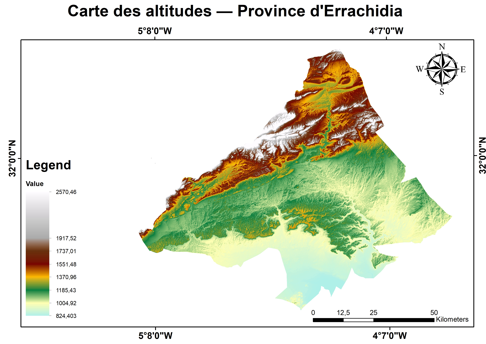

# SIG — Cartographie agricole et environnementale d’Errachidia

Projet académique de cartographie sous **ArcGIS ArcMap 10.8**, consacré aux caractéristiques environnementales de la province d’Errachidia, à la sensibilité à la désertification et aux zones favorables à l’agriculture.

**Auteurs mentionnés dans le rapport : Abdelhakim Kabouri, Hassane Oulberj et Mohammed Ouhra.**

## Cartes

Les images ci-dessous sont les exports fournis dans `Carte/Final_Crate`. Elles n’ont pas été recalculées pendant l’organisation du dépôt.

### Localisation

### Zones favorables à l’agriculture

### Sensibilité environnementale

Voir les cartes thématiques

## Contenu

- `arcmap/` : copies des documents MXD, avec sources réparées et chemins relatifs.
- `data/` : uniquement les jeux de données nécessaires aux couches activées dans ces copies.
- `maps/` : exports cartographiques fournis.
- `docs/layers.json` : correspondance entre les couches, leurs sources et les données copiées.
- `docs/excluded-hidden-layers.json` : couches masquées retirées des copies de publication.

## Ouvrir le projet

Télécharger l’ensemble du dépôt et conserver les dossiers `arcmap` et `data` au même niveau. Ouvrir un fichier `.mxd` dans ArcMap 10.8. GitHub affiche les cartes JPEG, mais n’exécute pas les projets ArcMap.

Les données raster au format ESRI GRID sont des dossiers : conserver tous leurs fichiers et les dossiers `info` associés. Les shapefiles nécessitent notamment les fichiers `.shp`, `.shx`, `.dbf` et `.prj`.

## Méthodologie documentée

Le rapport source décrit une analyse multicritère AHP-SIG et un indice ESAI-MEDALUS, utilisant des données de relief, précipitations, occupation du sol et végétation. Les sources citées comprennent CHELSA, ALOS PALSAR, Sentinel-2 et ESA WorldCover. Les résultats ne sont pas recalculés dans cette livraison.

## Périmètre de la sélection

La sélection repose sur les couches **activées dans les 11 MXD du dossier `Carte/ArcMap`**. Une couche masquée n’est pas nécessairement inutile : elle peut avoir servi à un calcul antérieur. Le dépôt vise la consultation des cartes et de leurs données affichées ; il ne constitue pas une archive complète du processus de calcul.

Les anciennes variantes JPEG, téléchargements bruts non référencés par les couches retenues, articles et documents de travail restent dans le dossier original. Les deux variantes de carte ESAI du dossier final sont conservées sans supposer laquelle a été validée définitivement.

## Vérification et réutilisation

Les copies MXD sont rouvertes avec ArcPy pour vérifier les sources cassées. Les liens réparés ne constituent pas une validation scientifique des cartes ni une comparaison visuelle de chaque rendu.

Les données et fonds cartographiques conservent les conditions de leurs fournisseurs. Aucune licence globale n’est attribuée aux données tierces. Conserver les noms des auteurs et citer les sources pour toute réutilisation.

## Publication GitHub

Les données nécessitent **Git LFS** : deux fichiers raster dépassent 100 Mo. Avant le premier `git add`, installer Git LFS puis exécuter `git lfs install` dans le dépôt. Le fichier `.gitattributes` suit tout le dossier `data/` avec LFS. Vérifier l’espace LFS disponible sur votre compte avant l’envoi.

Pour télécharger les données après clonage : `git lfs pull`. Le téléchargement ZIP proposé par GitHub peut contenir des pointeurs LFS plutôt que les données selon la configuration du dépôt.
